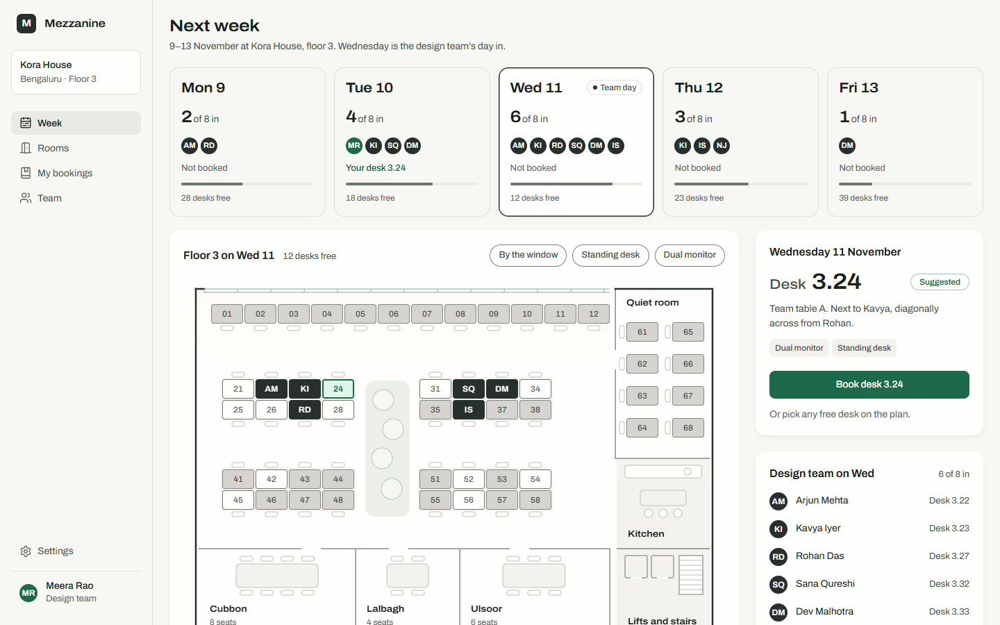
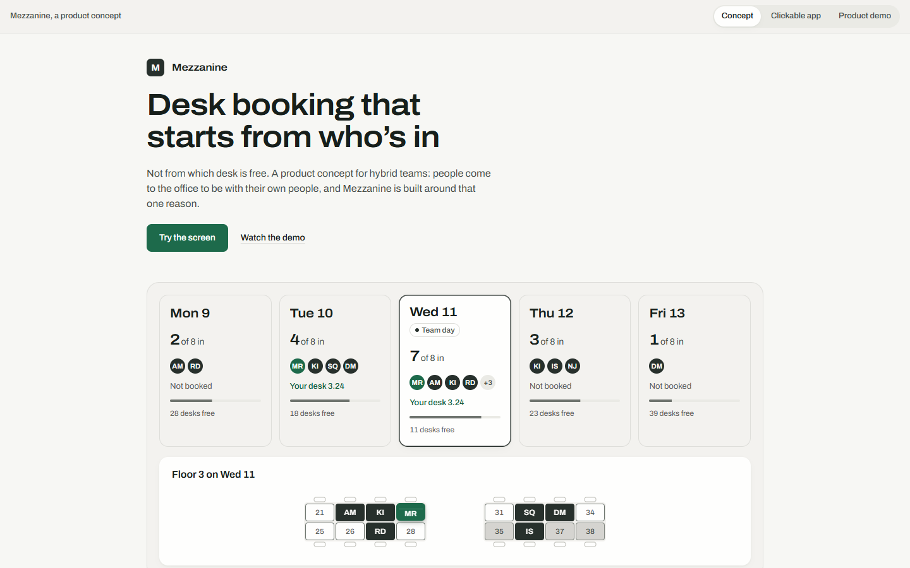
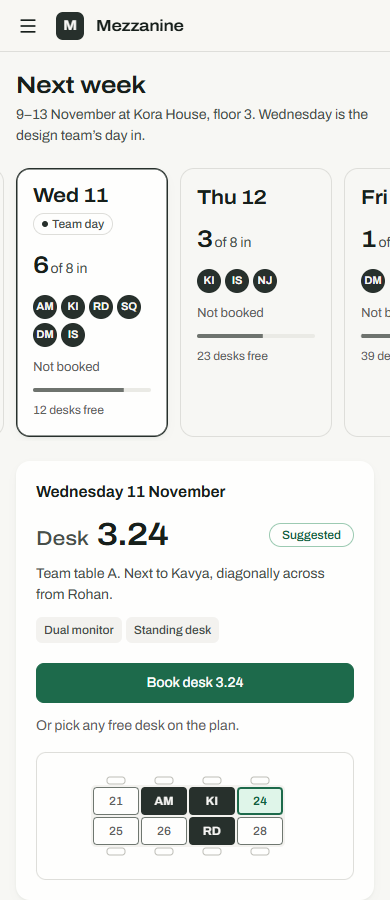
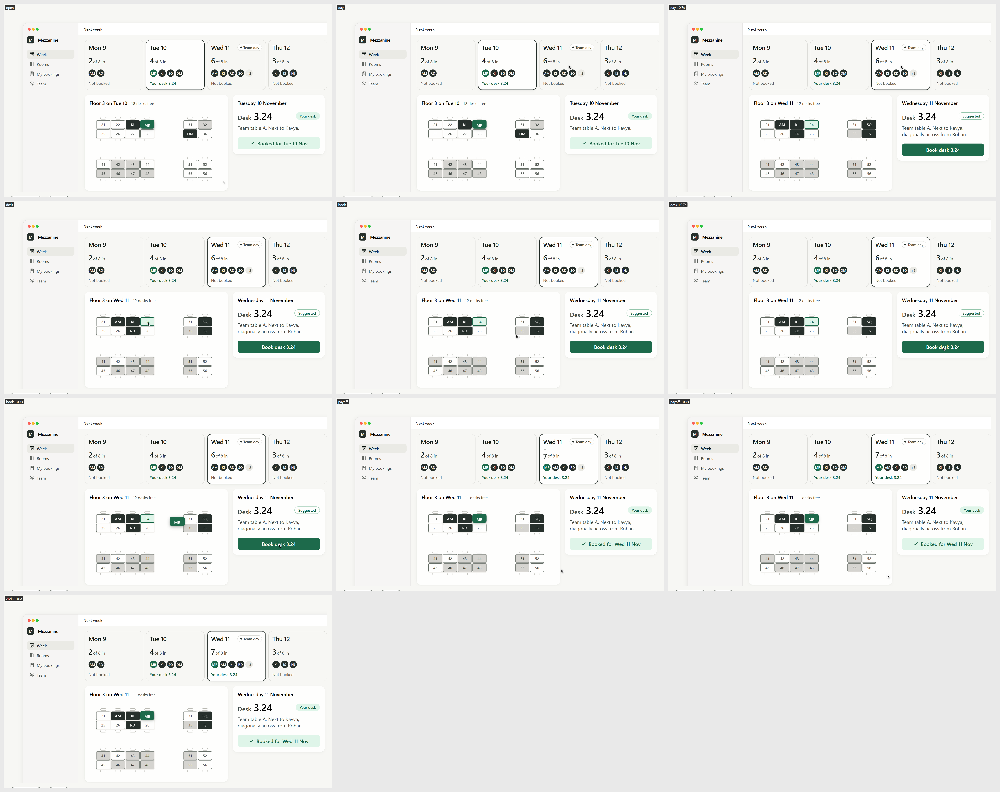
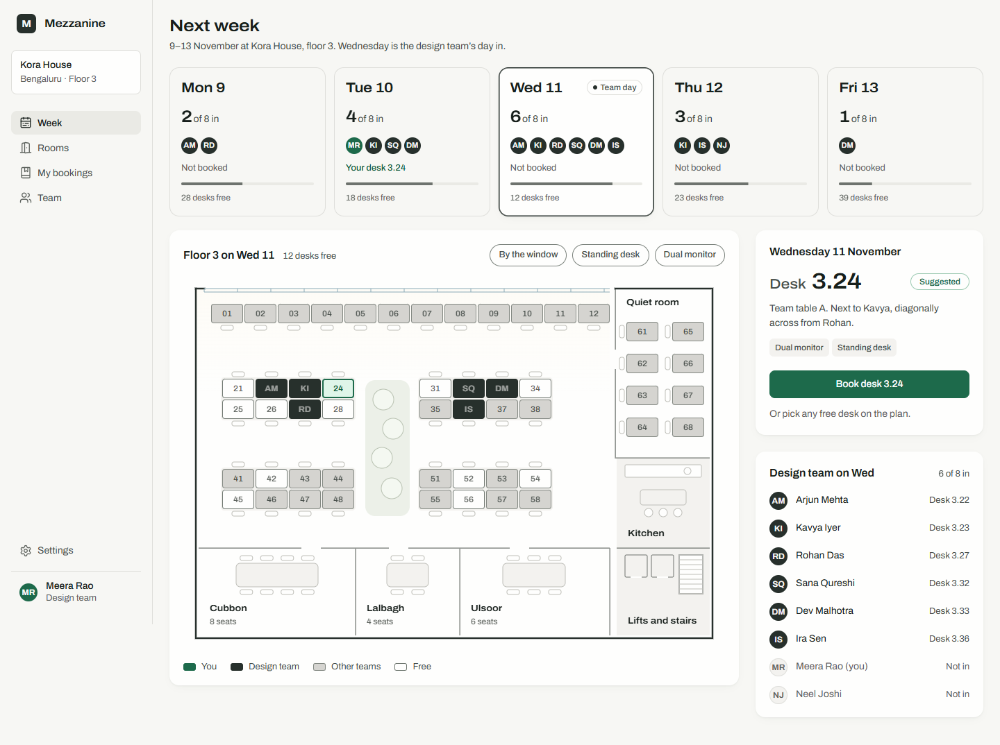

# Mezzanine

**Desk booking for hybrid teams that starts from who is in, not which desk is free.** You see which days your team is
in the office, pick the day that counts, and book the free desk closest to your teammates. Your booking lands on the
floor plan as a place card next to theirs.



## What it is

- **Clickable app** (`app/index.html`): a week strip showing who on your team is in each day, an architect-style floor
  plan (52 desks you can click or reach with the arrow keys, meeting rooms, filters), the suggested desk nearest your
  team, book / move / cancel with an 8-second undo, and who's in. On a phone the action card comes first with an inset
  map.
- **Self-playing demo** (`app/demo.html`): Tuesday → Wednesday → book a desk → the place card flies to the plan.
- **Concept page** and one page with all three views (`app/showcase.html`, built into `publish/mezzanine.html`),
  switched by `#concept` / `#app` / `#demo`.

## Who it's for

Members of hybrid teams (5 to 15 people) in a shared office, planning the coming week on a laptop.

## Status

A design **prototype, paused**. It builds and its checks pass (lint, render checks at desktop and phone sizes,
contrast), but two independent design reviews asked for another design round (a bolder concept page, a stronger
team-day mark, larger UI text), and that round has not been done. One light theme only. Rooms, parking and
office-manager tools are out of scope. Details and the open list: [design-notes/mezzanine.md](design-notes/mezzanine.md).

## Privacy

Everything runs in your browser; nothing is stored and nothing is sent to a server. The office, the team (for example
"Meera Rao") and all bookings are invented sample data for 9–13 November 2026.

## Built with

React 19, TypeScript, Vite 8, Number Flow (rolling figures), lucide-react icons, Archivo (bundled via Fontsource).
The demo uses a small demo kit of my own, vendored in `app/src/kit/`; `app/src/recipes/` holds my reusable
interaction pieces (morph button, scroll fade).

## Run it

```sh
cd app && npm install && npm run dev
```

Then open http://127.0.0.1:5197/?day=wed (app) or http://127.0.0.1:5197/demo.html (demo). `npm run build` type-checks
and builds both to `app/dist/`; `npm run preview` serves the build.

**Single-file page:** `publish/mezzanine.html` is self-contained (fonts inlined, no outside requests); it is the page
body without an `<html>`/`<head>` wrapper, made for embedding. To rebuild it: `npm run build:showcase` in `app/`, then
`python -I package_showcase.py` here.

## Screenshots

| | |
|---|---|
|  |  |
|  |  |

More: [full concept page](docs/screenshots/concept-1440-full.png)

## How it was designed

- [design-notes/direction.md](design-notes/direction.md): the concept, the brief, the five lines, the candidates and
  the direction "architect's plan on a bright morning".
- [design-notes/mezzanine.md](design-notes/mezzanine.md): what was built, the checks, both reviews and the possible
  next step.

## Licence

MIT, see [LICENSE](LICENSE). Copyright (c) 2026 Ankeet Panda.

## Third-party notices

- **Archivo** font by The Archivo Project Authors (Omnibus-Type), SIL Open Font License 1.1.
  Source: https://github.com/Omnibus-Type/Archivo, installed from npm as `@fontsource-variable/archivo` and inlined as
  data in `publish/mezzanine.html`. The font is not covered by this repository's MIT licence.
- Icons: [Lucide](https://lucide.dev) (ISC licence), via `lucide-react`; also inlined in `publish/mezzanine.html`.
- npm packages keep their own licences (React, React DOM and Number Flow: MIT).

Full third-party licence texts are in [licenses/](licenses/).
